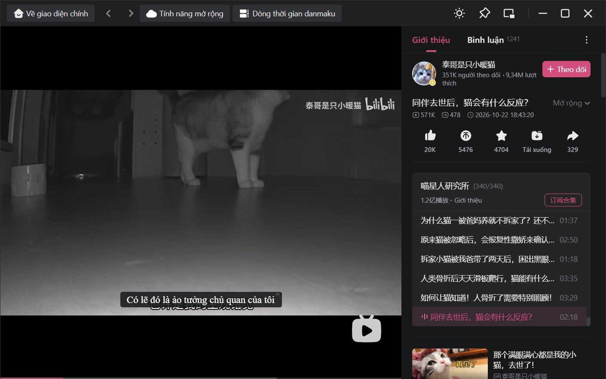
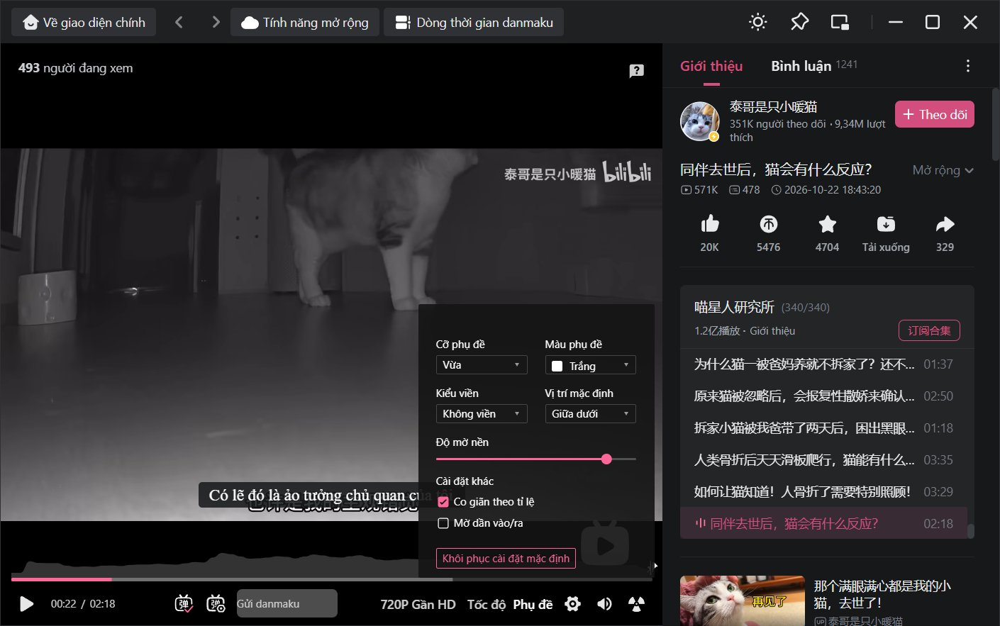
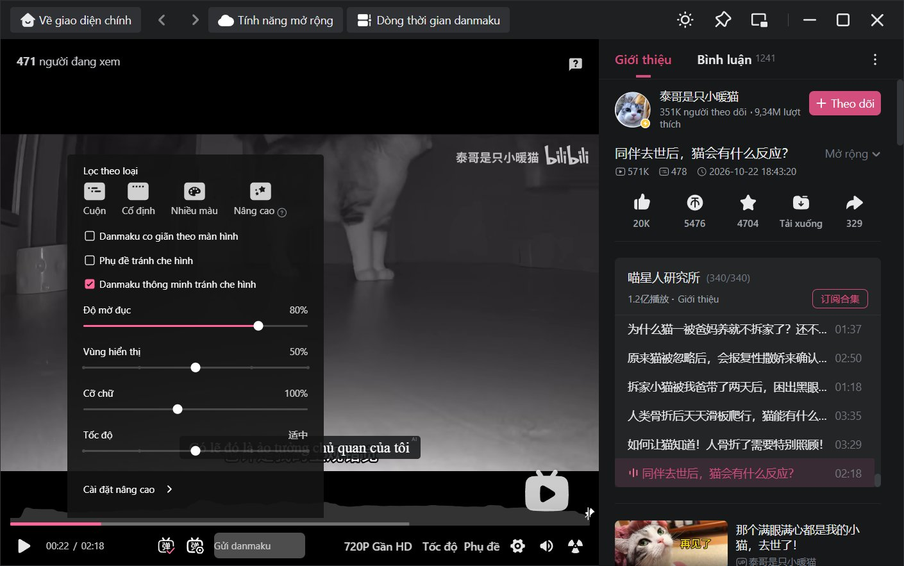
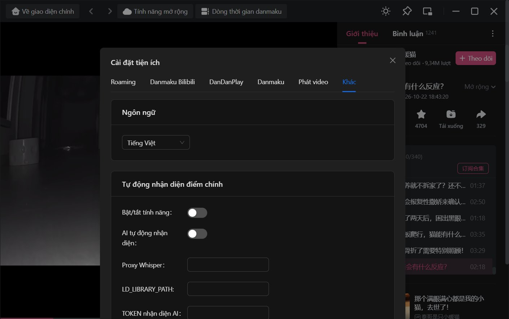

**[简体中文](README.MD) | [繁體中文](README_zh-tw.MD) | [English](README_en.MD) | Tiếng Việt**

<div align="center">

  

  <h3>Bilibili cho Linux / Windows — Bản tiếng Việt</h3>
  <br>

----

  Ứng dụng Bilibili trên máy tính với **giao diện tiếng Việt** và **phụ đề tiếng Việt dịch tự động**.

  Đây là bản fork của dự án gốc [msojocs/bilibili-linux](https://github.com/msojocs/bilibili-linux). Biểu tượng SVG của [@Peternal](https://github.com/Peternal).

  <br>
</div>

> [!NOTE]
> Dự án gốc: **https://github.com/msojocs/bilibili-linux** — toàn bộ phần lõi (vá client chính thức, roaming, SponsorBlock, ...) là công sức của tác giả gốc. Bản này chỉ bổ sung tiếng Việt. Các hướng dẫn nâng cao (tăng tốc GPU, Loongson, ...) xem trong [README tiếng Anh](README_en.MD) của dự án gốc.

## Điểm khác so với bản gốc

1. **Giao diện tiếng Việt** (mặc định ở lần chạy đầu tiên): hơn 500 chuỗi và các mẫu câu có tham số (thời gian, số lượt thích/người theo dõi, chất lượng video, ...) trong [`src/extension/common/translation/vi.ts`](src/extension/common/translation/vi.ts), cùng bảng cài đặt tiện ích ở [`src/extension/ui/locales/vi.ts`](src/extension/ui/locales/vi.ts).
2. **Phụ đề tiếng Việt dịch tự động**: mỗi video có phụ đề sẽ có thêm mục **"Tiếng Việt (tự động)"** trong menu phụ đề của trình phát. Dịch bằng Google Translate, có thể dùng cho cả chế độ phụ đề song ngữ.
3. **Hiển thị đúng dấu tiếng Việt**: dùng bộ font hỗ trợ đầy đủ dấu (Segoe UI, Roboto, Noto Sans, DejaVu Sans, ...), loại trừ phông icon và danmaku để không làm hỏng giao diện.
4. **Sửa bố cục khi chữ dài hơn tiếng Trung**: bảng cài đặt phụ đề, bảng cài đặt danmaku, hộp thoại điều khoản (trước đây nút "Đồng ý" bị tràn ra ngoài khung và không bấm được), nút gửi danmaku, ...
5. **Sửa phụ đề cho client 1.19**: trình phát mới lấy danh sách phụ đề bằng protobuf (`x/v2/subtitle/web/view`), nên bản này chèn thêm track vào đúng endpoint đó.

Vẫn giữ nguyên các tính năng của bản gốc: không có thanh tiêu đề khó chịu, hỗ trợ toàn màn hình cho màn hình độ phân giải thấp, kiểm tra cập nhật, menu thoát ứng dụng, roaming, tìm kiếm ở khu vực khác, [chia sẻ danmaku](docs/help/弹幕共享.MD) (tiếng Trung), SponsorBlock, ...

## Ảnh chụp

| Trang chủ | Phụ đề tiếng Việt |
|---|---|
|  |  |

| Cài đặt phụ đề | Cài đặt danmaku |
|---|---|
|  |  |



## Cách sử dụng

### Tải bản dựng sẵn

Tải ở trang Release: **https://github.com/kikuly/bilibili-linux-vn/releases**

| Hệ điều hành | Tệp | Ghi chú |
|---|---|---|
| Windows x64 | `bilibili-vi-1.19.0-x64.exe` | Trình cài đặt NSIS, cho phép chọn thư mục cài. Tệp chưa được ký số nên Windows SmartScreen có thể cảnh báo ("More info" → "Run anyway"). |
| Linux x64 (AppImage) | `bilibili-vi-1.19.0-x86_64.AppImage` | Chạy trực tiếp trên hầu hết các bản phân phối. Cần quyền thực thi; nếu thiếu FUSE thì chạy với `--appimage-extract-and-run`. |
| Linux x64 (rpm) | `bilibili-vi-1.19.0.x86_64.rpm` | Cho Fedora, openSUSE và các bản phân phối dùng rpm; cài vào `/opt/bilibili`. |
| Linux x64 (tar.gz) | `bilibili-v1.19.0-vi.1-x64.tar.gz` | Giải nén rồi chạy `bin/bilibili`. Đã gồm sẵn Electron 43.1.1. |

Linux:

```bash
# AppImage
chmod +x bilibili-vi-1.19.0-x86_64.AppImage
./bilibili-vi-1.19.0-x86_64.AppImage

# rpm (Fedora, openSUSE, ...)
sudo dnf install ./bilibili-vi-1.19.0.x86_64.rpm

# hoặc dùng tar.gz
tar xzf bilibili-v1.19.0-vi.1-x64.tar.gz
./bin/bilibili
```

> Bản Windows đã được chạy thử. Các gói Linux được dựng trong container Linux và mới chỉ kiểm tra được ở mức giải nén và khởi chạy mã của ứng dụng; **chưa được chạy thử có giao diện trên máy Linux thật**. Nếu gặp lỗi xin mở issue.

Nếu không muốn cài thêm một bản Electron, có thể lấy `app/app.asar` trong gói Linux và chạy bằng Electron đã có sẵn (khuyến nghị `43.1.1`).

### Tự build

Linux (theo dự án gốc):

```bash
git clone https://github.com/kikuly/bilibili-linux-vn.git
cd bilibili-linux-vn
tools/setup-bilibili.sh
bin/bilibili
```

Windows: các script trong `tools/` là bash, cần Git Bash. Tóm tắt các bước đã dùng để dựng bản `.exe`:

1. Tải bộ cài chính thức `https://dl.hdslb.com/mobile/fixed/bili_win/bili_win-install.exe` (phiên bản phải khớp `conf/bilibili_version`) và giải nén thư mục `resources` (cần 7-Zip bản đầy đủ vì đây là bộ cài NSIS).
2. Chạy `tools/fix-other.sh` (giải mã và vá `app.asar`, bỏ qua bước `cursor-tool` vì chỉ dùng cho Linux) rồi `tools/extension.sh` (build tiện ích mở rộng và nhét vào `app.asar`).
3. Chạy `electron-builder --win --x64 -c conf/build.json -c.electronVersion=43.1.1` để tạo bộ cài.

## Dùng phụ đề tiếng Việt

1. Mở một video có phụ đề (kể cả phụ đề AI của Bilibili; cần đăng nhập thì Bilibili mới trả về danh sách phụ đề).
2. Di chuột vào nút **Phụ đề** ở thanh điều khiển và chọn **Tiếng Việt (tự động)**.
3. Lần đầu bật ở mỗi video cần chờ vài giây để dịch; các lần sau dùng bản dịch đã lưu (IndexedDB, giữ 30 ngày).

Lưu ý:

- **Nội dung phụ đề được gửi tới Google Translate** (endpoint không chính thức `clients5.google.com/translate_a/t`) để dịch. Không bật tính năng này nếu bạn không muốn vậy.
- Endpoint không chính thức có thể bị Google giới hạn hoặc thay đổi bất cứ lúc nào; khi dịch lỗi, trình phát sẽ hiện phụ đề gốc.
- Mỗi dòng phụ đề được dịch riêng, không có ngữ cảnh xung quanh nên câu bị ngắt giữa hai dòng có thể chưa mượt.
- Video không có phụ đề nào thì không có gì để dịch.

## Đổi ngôn ngữ giao diện

1. Nhấn nút cài đặt ở góc dưới bên phải trang chủ.
2. Chọn **Cài đặt khác**.
3. Chọn ngôn ngữ ở mục **Ngôn ngữ**: 中文 / English / Tiếng Việt.

Quy ước bảo trì bản dịch xem ở [docs/Translation.md](docs/Translation.md). Những chuỗi nằm ngoài từ điển (tiêu đề video, tên UP, danh mục mới của Bilibili, ...) vẫn giữ nguyên tiếng Trung. Muốn bổ sung bản dịch, sửa `src/extension/common/translation/vi.ts` (và `en.ts` để hai bản luôn khớp khóa).

## Công cụ cho nhà phát triển

Nhấn <kbd>F12</kbd> để mở bảng công cụ nhà phát triển; nếu không có phản ứng thì tính năng này chưa được bật. Giao diện đăng nhập có hai lớp: chuột phải để mở lớp trong, <kbd>F12</kbd> cho lớp ngoài.

## Lịch sử thay đổi

[CHANGELOG.MD](CHANGELOG.MD)

## Cảm ơn các dự án

1. [msojocs/bilibili-linux](https://github.com/msojocs/bilibili-linux) — dự án gốc
2. [BiliRoaming](https://github.com/yujincheng08/BiliRoaming)
3. [bilibili-helper](https://github.com/ipcjs/bilibili-helper)
4. [BilibiliSponsorBlock](https://github.com/hanydd/BilibiliSponsorBlock)

## Tuyên bố miễn trừ

Giấy phép (MIT) chỉ áp dụng cho mã nguồn của dự án này, không áp dụng cho sản phẩm của Bilibili.

Bản quyền client Bilibili thuộc về Shanghai Kuanyu Digital Technology Co., Ltd.

Người duy trì không chịu trách nhiệm về bất kỳ sự cố phát sinh nào khi sử dụng dự án, chẳng hạn bị khóa hoặc mất tài khoản. Hãy cân nhắc trước khi dùng.

Mọi vấn đề về dự án gốc xin liên hệ tác giả gốc: jiyecafe@gmail.com
